# Embo — System management

*Monthly roster planning for multi-brand CX operations, built on the MERN stack (MongoDB, Express, React, Node).*

Embo plans, generates, validates and maintains monthly rosters for a team of 30+ people working across brands,
processes (CS, ACC, NDR, Retention…) and pods.

> **The core idea:** the unit that needs coverage is a **brand-process** (e.g. *Lumen Skincare · CS*). Each one has its
> own operating calendar, minimum staffing and shift. People **own** brand-processes (primary) or are trained **backups**.
> The scheduler builds a roster that satisfies those rules. A separate validator re-checks everything after every
> change. When a rule can't be met, the app flags it and explains it instead of producing an invalid roster.

- **Live app:** https://embo-roster-988e10ede415.herokuapp.com/
- **Stack:** React 18 + Vite + Zustand · Express 4 + Mongoose 8 · MongoDB · TypeScript throughout
- **Tests:** `npm test` runs 17 scheduling-engine tests

> **📝 Note — the dataset is made up.** All employee names (e.g. Rohan Mehta, Priya Nair), brand names (e.g. Bloom
> Botanics, PureSip) and pods in the sample data are **fictional**, created only to demonstrate the app; the leave
> records and holiday calendar are sample data too. Any resemblance to real people or companies is coincidental.

---

## Contents

1. [Screenshots](#screenshots)
2. [Project structure](#project-structure)
3. [Run it locally](#run-it-locally)
4. [Architecture](#architecture)
5. [REST API](#rest-api)
6. [Data model (MongoDB collections)](#data-model-mongodb-collections)
7. [How a roster is generated](#how-a-roster-is-generated)
8. [Validation: hard vs soft rules](#validation-hard-vs-soft-rules)
9. [Handling changes](#handling-changes)
10. [Sample data & scenarios](#sample-data--scenarios)
11. [Assumptions](#assumptions)
12. [Tell us how you think (the 8 questions)](#tell-us-how-you-think)
13. [Known limitations](#known-limitations)

---

## Screenshots

All screenshots show the sample (made-up) dataset with the December 2026 roster generated.

**1. Start screen** — before a month has a roster. One click generates it.
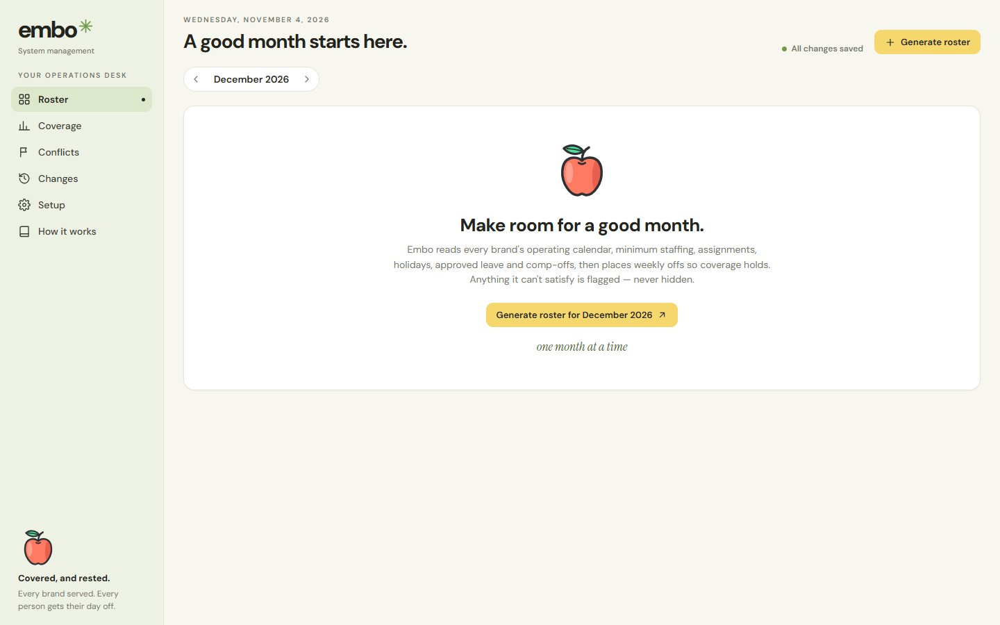

**2. Roster dashboard** — month overview: what still needs attention, % of required process-days covered, conflicts, backup cover days and weekly offs.
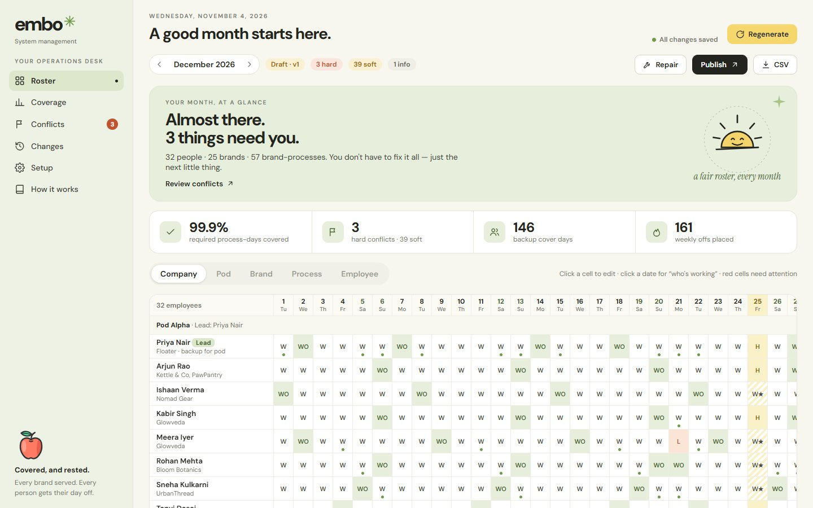

**3. Roster grid (Company view)** — every person × every day, grouped by pod with the lead first. W = working, WO = weekly off, L = leave, H = holiday, W★ = works a public holiday, green dot = covering as a backup.
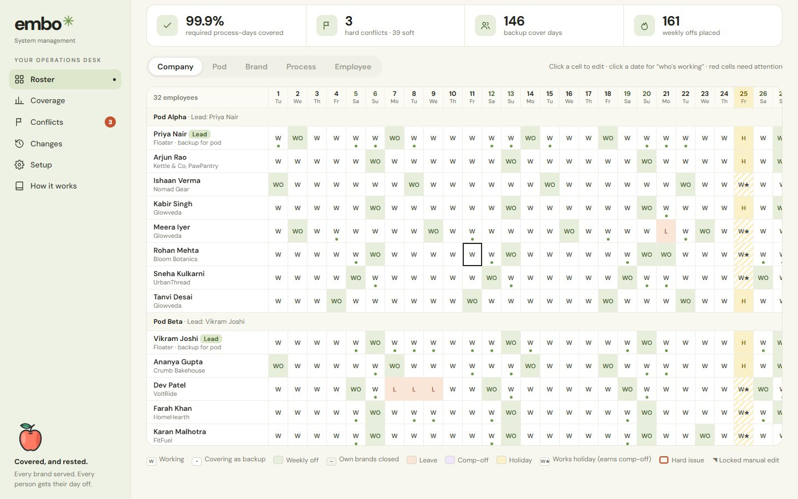

**4. Brand view (PureSip)** — coverage strip (on duty / required) per process, then owners and trained backups. Here 3 people share Customer Support, which needs 2 a day.
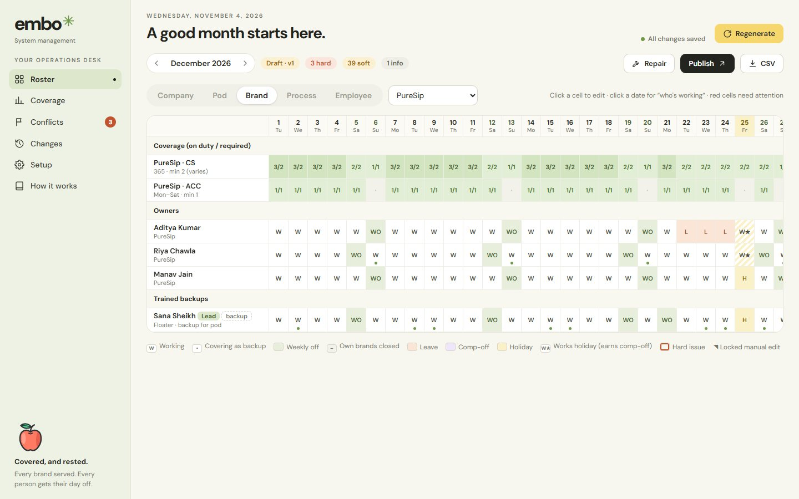

**5. Employee view (Rohan Mehta)** — working days, offs, leave, comp-offs, what they own and back up, and a monthly calendar.
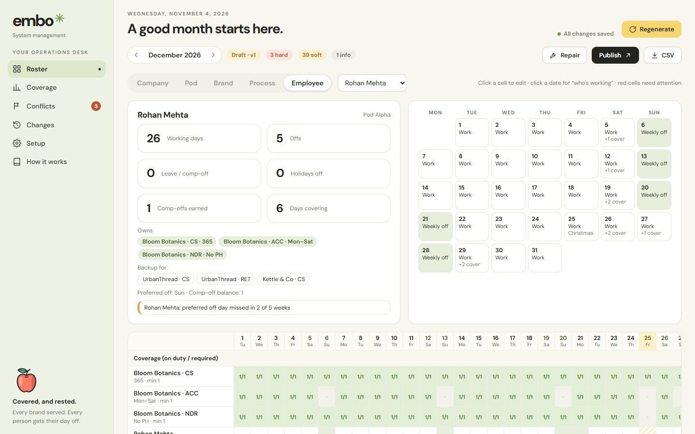

**6. Who's working (click a date)** — every brand-process for the day with its requirement and who is on duty; closed processes are marked.
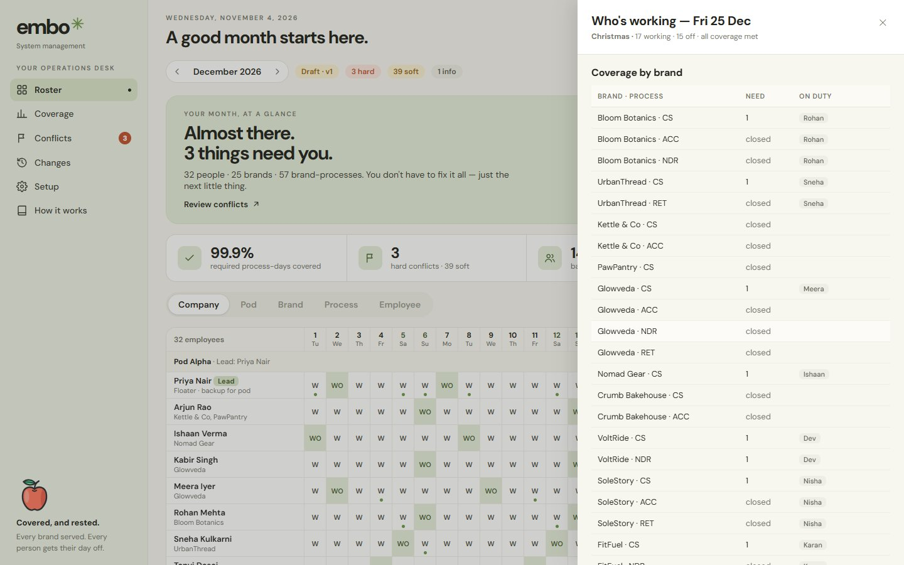

**7. Cell editor (click a cell)** — change a day's status, see today's responsibilities and load, add or remove backup covers. Edits are validated instantly and locked.
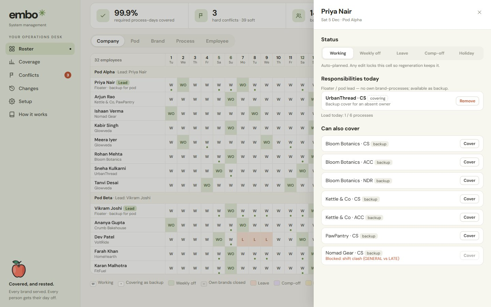

**8. Coverage** — the client's view: every brand × process × day. Green = met, red = short, grey = closed that day.
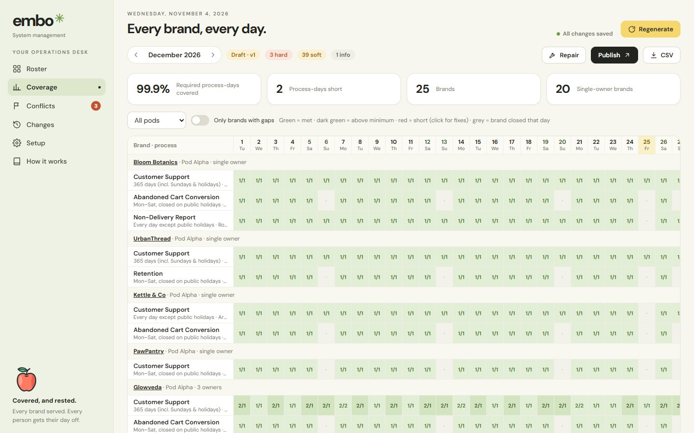

**9. Conflicts — an unresolvable gap, explained** — Trailblaze's only owner and only backup are both on leave; Embo lists everyone it considered and why they can't help.
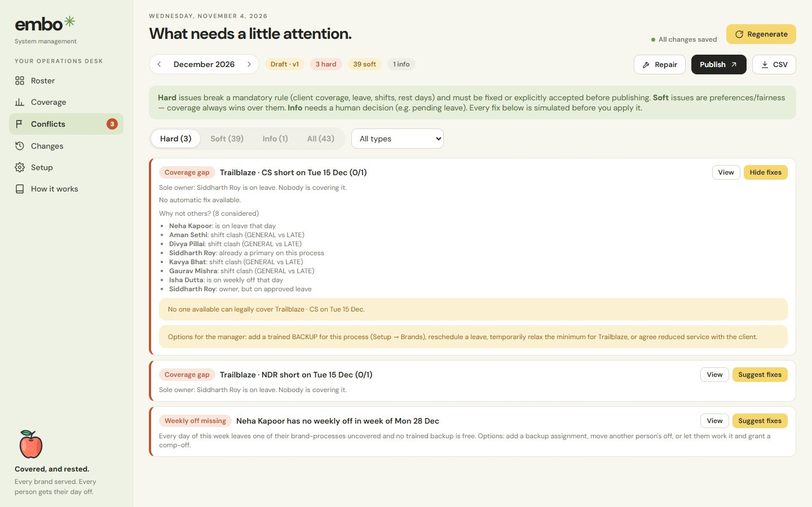

**10. Conflicts — simulated fixes** — every suggested fix is tested first and shows its effect (e.g. "Hard issues 3 → 2 · resolves this") before you apply it.
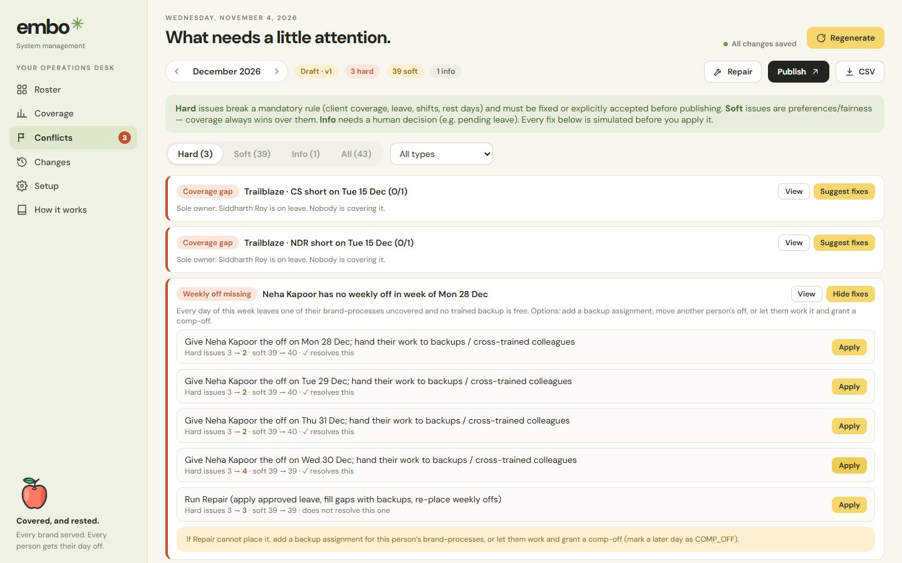

**11. Changes — absence simulator** — what happens if someone is unavailable: new issues with no action vs. after automatic repair, with a verdict per brand-process.
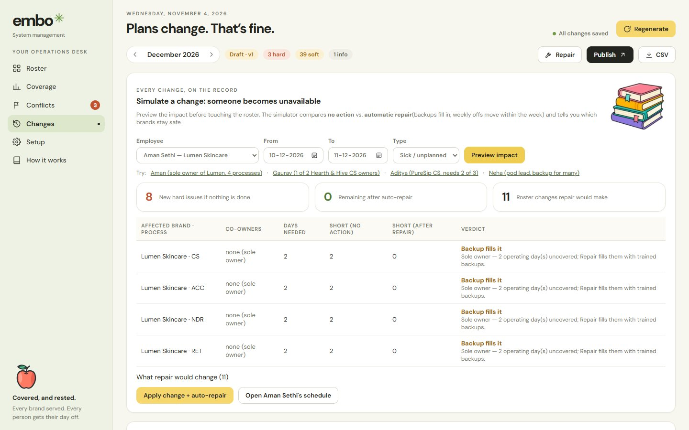

**12. Publish** — publishing with open hard issues requires an explicit acknowledgement, which is recorded in the change log.
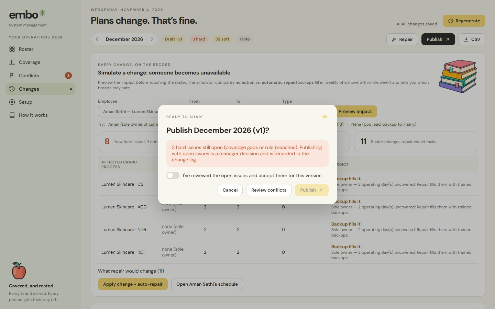

**13. Setup — brands, processes & assignments** — per-process operating calendar, shift, minimum staff (with per-weekday overrides), owners and backups.
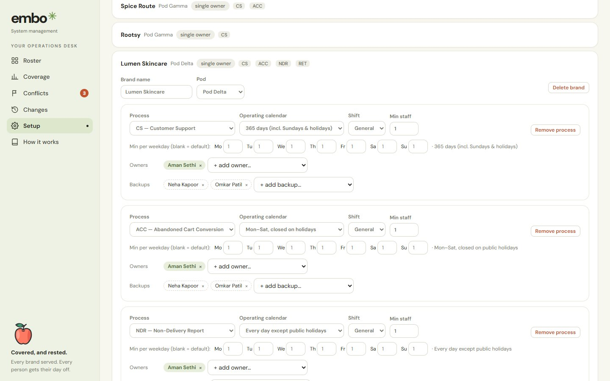

**14. Setup — employees** — pod, preferred weekly off, offs per week, comp-offs carried in, active switch.
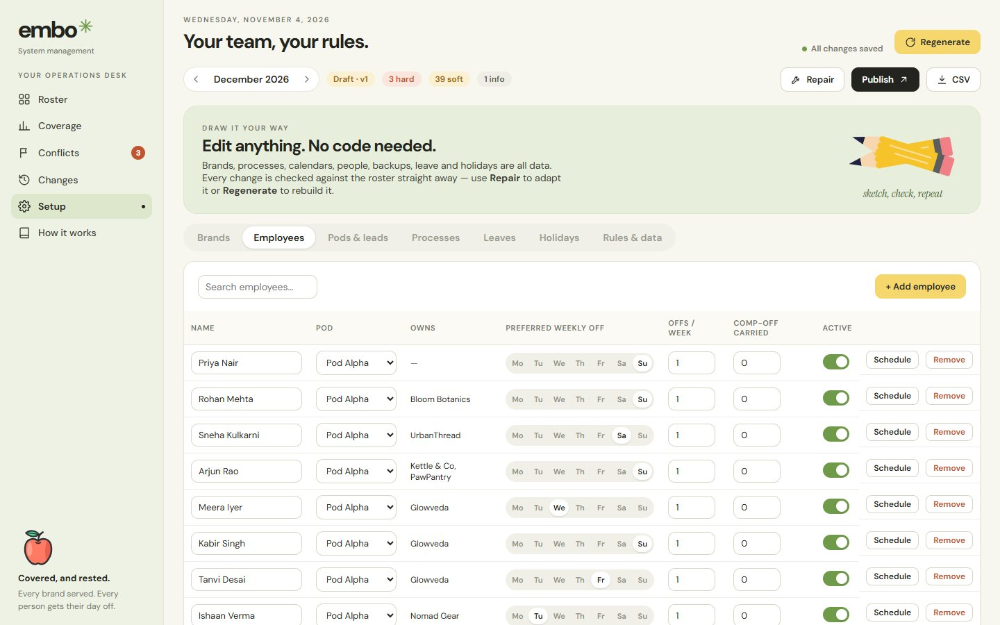

**15. Setup — leaves** — add leave and approve, keep pending or reject requests.
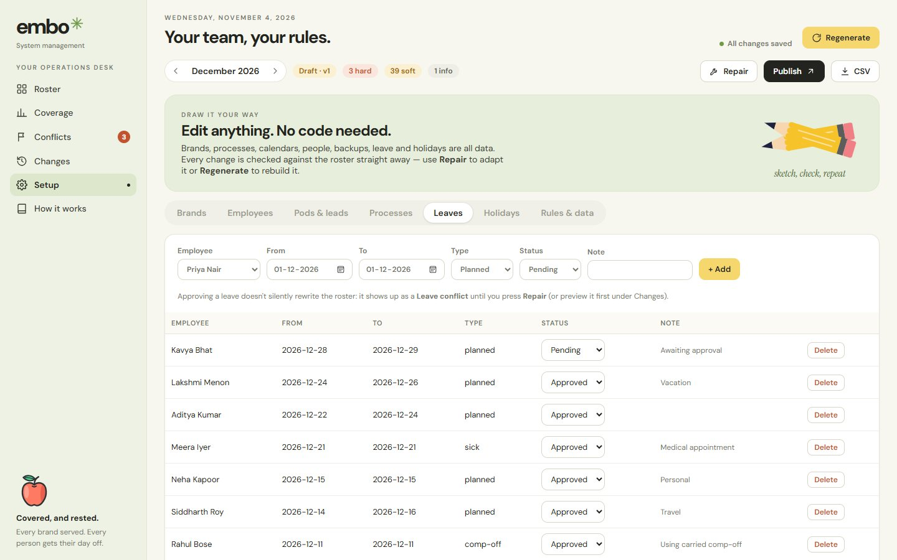

**16. How it works** — in-app explanation of generate → validate → edit & fix → handle changes.
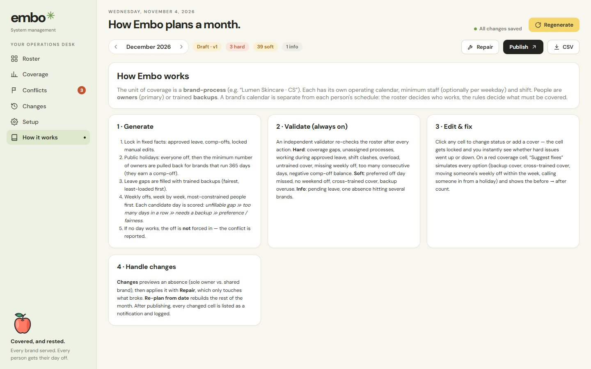

---

## Project structure

```
embo/
├─ client/                     React app (Vite)
│  ├─ index.html
│  ├─ vite.config.ts           dev proxy /api → :4000, @shared alias
│  └─ src/
│     ├─ main.tsx
│     ├─ api/
│     │  ├─ http.ts            fetch wrapper (VITE_API_URL)
│     │  └─ sync.ts            dataset diff → idempotent REST calls
│     ├─ store/
│     │  ├─ store.ts           Zustand store: load, autosave, server actions
│     │  └─ derived.ts         live validation hook + UI state
│     └─ ui/
│        ├─ App.tsx            layout, sidebar, header, publish flow
│        ├─ pages/             Roster, Coverage, Issues (Conflicts), Changes, Setup, Guide
│        ├─ components/        drawers, shared widgets, brand illustrations
│        ├─ assets/            images
│        ├─ export.ts          CSV / JSON export
│        └─ styles.css
├─ server/                     Express API (Node 20)
│  ├─ .env.example
│  └─ src/
│     ├─ index.ts              start-up: connect DB, seed if empty, listen
│     ├─ app.ts                Express app: /api routes + serves client/dist
│     ├─ config.ts             environment variables
│     ├─ db.ts                 Mongoose connection
│     ├─ models/index.ts       Mongoose schemas for every collection
│     ├─ routes/
│     │  ├─ collections.ts     CRUD for pods, employees, brands, … + settings
│     │  ├─ rosters.ts         roster CRUD + generate / repair / issues
│     │  └─ admin.ts           health, bootstrap, import, export, reset
│     ├─ services/
│     │  ├─ dataset.ts         Mongo ⇄ engine conversion, bulk load / replace
│     │  └─ rosters.ts         runs the scheduling engine server-side
│     ├─ middleware/http.ts    async handler, errors, 404
│     └─ scripts/seed.ts       npm run seed
├─ shared/                     Pure TypeScript used by BOTH client and server
│  └─ src/
│     ├─ engine/               types, calendar, context, generate, validate, suggest, impact, roster + tests
│     └─ data/seed.ts          sample dataset (32 people, 25 brands)
├─ screenshots/                README images
├─ package.json                npm workspaces + root scripts
└─ vitest.config.ts
```

---

## Run it locally

**Requirements:** Node.js 20+ and a MongoDB database (a local install at `mongodb://127.0.0.1:27017`, or any MongoDB connection string).

1. Install everything (all workspaces at once):

```bash
npm install
```

2. Create the server's environment file, then open it and set `MONGODB_URI` to your database:

```bash
cp server/.env.example server/.env
```

3. Start the API (port 4000) and the React dev server (port 5173) together:

```bash
npm run dev
```

Open http://localhost:5173. On first start with an empty database, the sample data is loaded automatically.

| Command (run in the project root) | What it does |
|---|---|
| `npm run dev` | API with auto-reload (tsx) + React dev server with hot reload |
| `npm test` | Scheduling-engine tests (Vitest) |
| `npm run typecheck` | Strict TypeScript check of client and server |
| `npm run build` | Builds `client/dist` (React) and `server/dist` (bundled API) |
| `npm start` | Runs the production server: API + built React app on one port |
| `npm run seed` | Reloads the sample dataset into MongoDB and clears rosters (`npm run seed -- 2026-12` to choose the month) |

**Environment variables** (`server/.env`):

| Variable | Default | Purpose |
|---|---|---|
| `MONGODB_URI` | `mongodb://127.0.0.1:27017/embo` | Database connection string |
| `PORT` | `4000` | API port |
| `CLIENT_ORIGIN` | *(empty)* | Allowed CORS origin(s), only if the React app is on another domain |
| `SEED_ON_EMPTY` | `true` | Load sample data when the database is empty |

`client/.env` only needs `VITE_API_URL` when the API is on a different domain.

---

## Architecture

```
┌──────────── Browser (React) ────────────┐        ┌──────────── Node / Express ────────────┐
│ UI pages ─► Zustand store               │  /api  │ routes ─► services ─► Mongoose models   │──► MongoDB
│   • optimistic updates                  │◄──────►│   • CRUD for every collection           │
│   • autosave (400 ms debounce,          │  JSON  │   • generate / repair / issues run the  │
│     idempotent PUT/DELETE, retries)     │        │     scheduling engine server-side       │
│   • live validation + fix simulation    │        │   • import / export / reset / bootstrap │
└──────────────┬──────────────────────────┘        └──────────────┬─────────────────────────┘
               └──────────── shared/  (pure TypeScript engine) ────┘
                 generate · validate · suggest · impact · calendar · types · sample data
```

Key decisions:

- **One engine, two places.** The scheduling engine is pure TypeScript in `/shared`. The **server** runs it for the heavy,
  authoritative actions: Generate, Re-plan and Repair, whose results are saved to MongoDB. The **browser** runs the same
  code for instant feedback: re-validating after each click, simulating every suggested fix, and the “what if someone is
  sick” preview. Both sides always agree because they run the same code.
- **MongoDB is the source of truth.** On load the client fetches everything with `GET /api/bootstrap`. Edits update the
  screen immediately and are saved in the background. Saves are batched 400 ms after the last change. The client diffs
  the last-saved state against the current one and sends only **idempotent** calls (`PUT` = create-or-replace,
  `DELETE` = remove-if-present), so a failed save can safely be retried. The header shows *All changes saved /
  Saving… / Not saved — retrying*.
- **Stable string ids.** Documents keep the app's own ids as `_id` (`"rohan"`, `"bloom-cs"`; holidays use the date;
  rosters use the month), so exports, the API and the UI all refer to the same keys.
- **Validation in two layers.** Mongoose schemas validate the shape of every write (types, enums, date formats). The
  engine's validator checks the *business rules* (coverage, rest days, shifts…).
- **Generator and validator are independent.** The validator never trusts the generator, so manual edits, imports and
  generated rosters are all checked the same way.
- **One server in production.** After `npm run build`, `npm start` runs Express, which serves both the API and the built
  React app (`client/dist`) from the same origin, so there's no CORS. The server is bundled with esbuild into
  `server/dist/index.js`.

---

## REST API

All endpoints are under `/api` and use JSON.

**System**

| Method | Path | Description |
|---|---|---|
| GET | `/health` | `{ ok, db }` liveness + database state |
| GET | `/bootstrap` | Everything the app needs: `{ data, rosters }` |
| GET | `/admin/export` | Full backup as JSON |
| POST | `/admin/import` | Replace everything with a backup `{ data, rosters }` |
| POST | `/admin/reset` | Restore the sample dataset `{ month?: "YYYY-MM" }` |

**Configuration collections**: `pods`, `employees`, `processes`, `brands`, `brand-processes`, `assignments`, `holidays`, `leaves`

| Method | Path | Description |
|---|---|---|
| GET | `/:collection` | List |
| GET | `/:collection/:id` | One document |
| POST | `/:collection` | Create (id optional; generated if missing; 409 if it exists) |
| PUT | `/:collection/:id` | Create or replace (idempotent; schema-validated) |
| DELETE | `/:collection/:id` | Delete (idempotent, 204) |
| GET / PUT | `/settings` | Global scheduling rules |

**Rosters** (`:month` = `YYYY-MM`)

| Method | Path | Description |
|---|---|---|
| GET | `/rosters` | All rosters, keyed by month |
| GET | `/rosters/:month` | One roster |
| PUT | `/rosters/:month` | Save (manual edits, applied fixes, publish) |
| DELETE | `/rosters/:month` | Delete |
| POST | `/rosters/:month/generate` | Run the scheduler. `{ freezeBefore?: "YYYY-MM-DD" }` re-plans from a date. Returns `{ roster, summary }` |
| POST | `/rosters/:month/repair` | Non-destructive repair. Returns `{ roster, actions, summary }` |
| GET | `/rosters/:month/issues` | Validation result `{ summary, issues }` |

Example:

```bash
curl -X POST http://localhost:4000/api/rosters/2026-12/generate -H "Content-Type: application/json" -d "{}"
```

---

## Data model (MongoDB collections)

```
pods            { _id, name, leadId }
employees       { _id, name, podId, preferredOffDays[], weeklyOffs, compOffOpening, active }
processes       { _id, code, name }                                   CS / ACC / NDR / RET / …
brands          { _id, name, podId }
brandprocesses  { _id, brandId, processId,                            ← the unit that needs coverage
                  rule: { mode: ALL_DAYS | NO_PH | NO_SUN_NO_PH | CUSTOM, weekdays[], holidaysOff },
                  shift: GENERAL | LATE, minStaff, weekdayMin{Mon:2…}, dateMin{date:n} }
assignments     { _id, employeeId, brandProcessId, type: PRIMARY | BACKUP }       many-to-many
holidays        { _id: "YYYY-MM-DD", name }
leaves          { _id, employeeId, from, to, type: PLANNED | SICK | COMP_OFF, status: APPROVED | PENDING | REJECTED, note }
settings        { _id: "settings", maxConsecutiveDays, maxResponsibilitiesPerDay, minDaysInWeekForOff }
rosters         { _id: "YYYY-MM", status: DRAFT | PUBLISHED, version, generatedAt, publishedAt,
                  cells{ date: { employeeId: { status, covers[], locked, source, offKind } } },
                  publishedCells, log[] }
```

**Brand calendar vs. employee schedule:** a brand-process's `rule` + `requiredStaff()` decide whether it operates on a day
and how many people it needs. The roster `cells` decide whether a person works. Coverage combines the two: working owners
plus anyone whose `covers` includes that brand-process.

---

## How a roster is generated

`generateRoster()` in `shared/src/engine/generate.ts`, called by `POST /api/rosters/:month/generate`:

1. **Fixed facts first.** Locked (manual) cells and frozen past days are kept. Approved leave and comp-offs are applied.
2. **Public holidays.** Everyone gets the holiday. Then the minimum number of owners is pulled back for 365-day
   processes, choosing whoever has worked the fewest holidays. Working a holiday earns a comp-off.
3. **Gaps caused by leave** are filled with trained backups. Each backup must be working, stay under the daily load cap,
   and have **no shift clash**.
4. **Weekly offs**, one Mon–Sun week at a time. The most urgent and most constrained people go first. Every candidate day
   is simulated with backups filled in, then scored:

   | Outcome | Cost |
   |---|---|
   | Brand-process left short, no backup available | 1000 per gap |
   | More than *max consecutive days* | 300 |
   | Needs a backup | 40 per process |
   | Someone called in from a holiday | 30 |
   | Not the preferred day | 25 |
   | A co-owner is already off | 6 |
   | Weekend repeat (fair rotation) | 4 × count |

   If every day costs ≥ 1000, **no off is forced in**. The validator reports *Weekly off missing* instead.
5. **A max-streak pass** catches streaks that cross week boundaries.
6. **Closed days** (all of a person's brands are closed) become offs. Then a final gap fill, and covers that are no longer
   needed are removed.

Generating takes about 50–70 ms for 32 people × 31 days.

---

## Validation: hard vs soft rules

| Severity | Rule | Meaning |
|---|---|---|
| HARD | Coverage gap | Fewer people on duty than required (with who is absent and why) |
| HARD | No assigned employee | An operating process with no owner |
| HARD | Leave conflict | Rostered during approved leave |
| HARD | Incompatible shifts | GENERAL and LATE work on the same day |
| HARD | Overloaded | More brand-processes in a day than the cap |
| HARD | Untrained cover | Covering without being a backup or cross-trained |
| HARD | Weekly off missing | A qualifying week without the weekly off |
| HARD | Too many days in a row | Streak longer than the limit (default 6) |
| HARD | Comp-off balance | More comp-offs used than carried in plus earned |
| SOFT | Preference not met · No weekend off · Cross-trained cover · Backup overused | Fairness / preferences |
| INFO | Pending leave · Multi-brand impact | Needs a decision / impact summary |

Client coverage beats preferences (cost 1000 vs 25). Publishing with open HARD issues requires an explicit
acknowledgement, which is recorded in the log. **Suggested fixes** are each simulated on a copy of the roster and shown
with their effect (“Hard issues 3 → 2 · ✓ resolves this”) before you apply them.

---

## Handling changes

1. **Manual edit:** click a cell. The change is validated instantly, the cell is locked, and it's saved to MongoDB.
2. **Repair** (`POST /repair`): non-destructive. It syncs leave, drops invalid covers, fills gaps with backups, moves
   weekly offs within the week (including chain moves), and re-places missing offs.
3. **Re-plan from a date** (`POST /generate` with `freezeBefore`): rebuilds the rest of the month and keeps past days and
   locked cells.
4. **Change simulator** (Changes page): shows the impact of an absence with no action vs. with repair, and a verdict for
   each brand: *Covered / Backup fills it / At risk*. *Apply* saves the leave and runs Repair on the server.
5. **Publishing:** saves a snapshot. Every later cell change is listed as “changes since publish” (who to notify).

---

## Sample data & scenarios

**All names in the sample dataset (employees, brands and pods) are made up for demonstration.**

32 employees in 4 pods, 25 brands (20 single-owner = 80%, 5 with 2–3 people), 57 brand-processes. Leave is placed
relative to the month the database was seeded for:

| Scenario | What you'll see |
|---|---|
| Dev (VoltRide, sole owner) on leave on the 7th–9th | Vikram / Farah cover automatically |
| Siddharth (Trailblaze, late shift) on leave on the 14th–16th **and** Neha (his only backup) on the 15th | **Unresolvable gap flagged** with reasons |
| Meera sick on the first Monday after the 15th (Glowveda CS needs 2) | Tanvi + backup Kabir keep it at 2 |
| Aditya (PureSip CS, needs 2 of 3) on leave on the 22nd–24th | Riya + Manav cover |
| Rahul uses a comp-off; Kavya has a pending request | Comp-off balance; INFO awaiting a decision |

---

## Assumptions

1. One shift per person per day (GENERAL or LATE).
2. Weeks run Monday–Sunday. A week earns a weekly off if at least 4 of its days fall in the month (setting).
3. At most 6 consecutive working days (setting). Months are planned independently.
4. At most 6 brand-processes per person per day (setting).
5. One company-wide holiday list. Working a holiday earns 1 comp-off.
6. A public holiday is never used as a weekly off. Leave doesn't count as a weekly off.
7. Only designated backups are used automatically; cross-trained colleagues are suggested only.
8. Pending leave doesn't change the roster. Approved leave applies on Repair.
9. Concurrent editors: the last save wins. There is no locking between two managers editing at the same time.

---

## Tell us how you think

**1. How did you model employees, brands, processes, pods, and their relationships?**
Around the **brand-process**: one document per *(brand, process)* that holds the client's contract for that work
(operating calendar, minimum staff with weekday/date overrides, shift). Employees link to brand-processes through a
many-to-many `assignments` collection typed `PRIMARY` or `BACKUP`. One structure covers every pattern in the brief: sole
owners, split processes, shared processes with `minStaff > 1`, and people working across brands. Pods group employees and
brands and point to a lead. Rosters are a separate collection keyed by month, so the brand calendar and a person's schedule
are never mixed; coverage is computed from both.

**2. How does your system generate a roster and determine whether it satisfies the required constraints?**
A deterministic greedy scheduler with simulation-based scoring, plus local repair passes, runs on the server. It is
checked by an **independent validator** that recomputes every rule from the saved cells. The tests prove that the reported
gaps match the real gaps exactly, so an invalid roster is never presented as valid.

**3. How did you handle the difference between single-resource brands and brands with multiple employees?**
The same algorithm covers both. For a sole owner, every day off creates gaps, so those people are scheduled first, on the
day that needs the fewest backups, and the gaps are filled by trained backups. For multi-owner brands, offs are cheap while
the others still meet the minimum. A co-owner penalty spreads their offs, and weekday minimums are respected. The change
simulator labels the two cases differently.

**4. What happens when an employee manages all processes for a brand but is unavailable on a required working day?**
Every operating process of that brand shows a hard coverage gap naming the owner and the reason. If they own several
brands, an INFO item groups the impact. Repair assigns the best qualified backup, or moves a weekly off (including chain
moves). If nobody qualifies, the gap stays flagged, and the suggestions list every candidate and why they can't help, plus
the manager's options.

**5. How does your system handle conflicting requirements or insufficient staffing?**
By explicit priority: client coverage, then labour rules, then preferences and fairness, encoded as costs. The generator
never silently breaks a mandatory rule. Conflicts are reported as HARD issues with simulated fixes, and publishing with
open issues requires an acknowledgement.

**6. Which parts did you automate, and which did you leave under human control? Why?**
*Automated:* generation, holidays and leave, backup choice, weekly offs, validation, fix simulation, impact analysis,
repair, CSV export and change tracking. *Human:* approving leave, publishing, applying fixes, using cross-trained staff,
call-ins and client trade-offs. These decisions affect people and contracts, and the algorithm only knows the data it has.

**7. If the company doubled its team and brand count, what would you change?**
The MERN split already moves the data to a shared database and the heavy work to the server. Next steps: authentication and
roles (ops manager, pod-lead approvals, employee self-service), optimistic-concurrency version checks on roster saves,
planning per pod (most coverage stays inside a pod), running generation in a worker queue, and a CP-SAT/ILP solver for
fairness across months, with the same validator as the acceptance check.

**8. If you had one additional week, what would you improve first?**
Cross-month continuity (streaks and comp-off balances), a fairness dashboard, login with roles and approval workflows,
real notifications (email/Slack) for post-publish changes, and a side-by-side comparison of alternative plans.

---

## Known limitations

- No login yet: anyone with the URL can edit. Add authentication before real use.
- Last write wins if two people edit the same roster at the same moment.
- Months are planned independently. There are two shift types.
